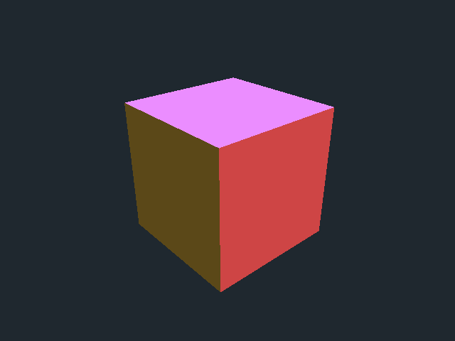

# D3DImage: sharing a Direct3D surface with WPF

> A walk-through of WPF's `D3DImage` — the interop surface that lets a **Direct3D** scene composite into
> the WPF visual tree like any other image, with **no airspace problem**. We render a spinning, lit cube
> with Direct3D 9Ex's fixed-function pipeline and feed its surface to `D3DImage`, finishing the exact
> `SetBackBuffer` call the original demo left blank.

*By Richard Potter. The source discussed here lives in this repository under `src/D3DImageCube/`.*



**Contents**

- [Introduction](#introduction)
- [What D3DImage actually is](#what-d3dimage-actually-is)
- [Why Direct3D 9Ex](#why-direct3d-9ex)
- [The off-screen render target](#the-off-screen-render-target)
- [A cube with fixed-function lighting](#a-cube-with-fixed-function-lighting)
- [The world-matrix trap](#the-world-matrix-trap)
- [The lock / set / dirty / unlock dance](#the-lock--set--dirty--unlock-dance)
- [Running it](#running-it)
- [Going further](#going-further)
- [Summary](#summary)

---

## Introduction

The original version of this demo was a single WPF window with an `Image` and one suggestive,
unfinished line of code:

```csharp
D3DImage d3d = new D3DImage();
image.Source = d3d;
d3d.SetBackBuffer(D3DResourceType.IDirect3DSurface9, );   // ← the demo stopped here
```

That trailing comma is the whole point of the exercise. `D3DImage.SetBackBuffer` wants a pointer to an
`IDirect3DSurface9`, and the demo never produced one. This rewrite supplies it — a real Direct3D 9Ex
render target with a lit cube drawn into it — and brings the project to **.NET 10** using
[**Vortice.Windows**](https://github.com/amerkoleci/Vortice.Windows), the modern .NET DirectX bindings.

If you want the *other* way to mix Direct3D and WPF — giving Direct3D its own native child window — see
the sibling project [**DirectXCube**](https://github.com/dickiepotter/DirectXCube). The two projects are
deliberate opposites; the comparison is most of the lesson.

## What D3DImage actually is

`D3DImage` is an `ImageSource`. That one fact is why it matters. Because it *is* an image as far as WPF
is concerned, the Direct3D output it wraps:

- composites with the rest of the scene (no separate top-most window),
- can be scaled, rotated, clipped, made partly transparent, or have WPF content drawn over it,
- lives in normal WPF layout.

That is the thing `WindowsFormsHost` cannot do. The host technique (see
[DirectXCube](https://github.com/dickiepotter/DirectXCube)) is simpler and a hair faster, but its 3D
rectangle always sits *on top* of WPF — the **airspace** limitation. `D3DImage` trades a per-frame GPU
copy for getting rid of airspace entirely. In [`MainWindow.xaml`](src/D3DImageCube/MainWindow.xaml) the
whole UI is just:

```xml
<Image x:Name="Surface" Stretch="Uniform" RenderOptions.BitmapScalingMode="HighQuality" />
```

and we point its `Source` at a `D3DImage`.

## Why Direct3D 9Ex

`D3DImage` was introduced in .NET 3.5 / Vista and is built around a **Direct3D 9** surface
(`IDirect3DSurface9`). For it to share a surface efficiently with WPF's own compositor, the surface must
come from a **Direct3D 9Ex** device — the Vista-era extended device that supports shareable,
video-memory surfaces. So even on a 2026 machine, this specific interop path speaks D3D9Ex. Creating the
device in [`CubeRenderer.cs`](src/D3DImageCube/CubeRenderer.cs) is a one-liner with Vortice:

```csharp
_d3d = Direct3DCreate9Ex();
_device = _d3d.CreateDeviceEx(0, DeviceType.Hardware, focusWindow,
    CreateFlags.HardwareVertexProcessing | CreateFlags.Multithreaded | CreateFlags.FpuPreserve,
    presentParameters);
```

Working in D3D9 also means we get the **fixed-function pipeline** back — built-in transforms, lighting
and materials, no shaders required. That is exactly what the Managed DirectX era used, so it keeps this
demo faithful to its roots while being far less code than the HLSL path its D3D11 sibling needs.

## The off-screen render target

We never present to the screen with Direct3D here — WPF does the presenting. Instead we draw into an
off-screen **render-target surface** and a matching **depth-stencil surface**:

```csharp
_renderTarget = _device.CreateRenderTarget(
    width, height, Format.A8R8G8B8, MultisampleType.None, 0, lockable: false);
_depthStencil = _device.CreateDepthStencilSurface(
    width, height, Format.D24S8, MultisampleType.None, 0, discard: true);

_device.SetRenderTarget(0, _renderTarget);
_device.DepthStencilSurface = _depthStencil;
```

Two details matter for `D3DImage`: the format must be one it accepts (`A8R8G8B8` here), and the surface
must be **non-lockable** so it lives in video memory and can be shared with the compositor. Its native
pointer — `_renderTarget.NativePointer` — is what we'll hand to `SetBackBuffer`.

## A cube with fixed-function lighting

The geometry is the familiar six faces of two triangles each, but lighting is configured rather than
coded. We switch on the lighting pipeline, add one **directional light**, and rely on the **depth
buffer** (with culling off) so winding order can't make faces disappear:

```csharp
_device.SetRenderState(RenderState.Lighting, true);
_device.SetRenderState(RenderState.ZEnable, true);
_device.SetRenderState(RenderState.CullMode, (int)Cull.None);
_device.SetRenderState(RenderState.Ambient, unchecked((int)0xFF606060));

var light = new Light9 { Type = LightType.Directional, Diffuse = Rgb(1, 1, 1),
                         Direction = Vector3.Normalize(new Vector3(-0.4f, -0.6f, -0.7f)) };
_device.SetLight(0, ref light);
_device.LightEnable(0, true);
```

Each face's colour is supplied as a **material** just before its two triangles are drawn — the classic
fixed-function way to colour geometry under lighting:

```csharp
var material = new Material9 { Diffuse = _faceColors[f], Ambient = _faceColors[f] };
_device.SetMaterial(ref material);
_device.DrawPrimitiveUP(PrimitiveType.TriangleList, 2, _verticesPtr + f * 6 * VertexStride, VertexStride);
```

## The world-matrix trap

One subtlety bites everyone who drives D3D9 from a modern binding. The fixed-function pipeline has three
transform slots — world, view, projection — but Vortice's `TransformState` enum only names `View`,
`Projection` and the texture stages. The world matrix is `D3DTS_WORLD`, whose value is **256**, and
Vortice's *integer* `SetTransform` overload treats its argument as a world-matrix **index** (it adds the
256 base for you). Passing `256` to that overload therefore lands on the wrong slot and your cube never
rotates. The fix is to cast to the enum explicitly:

```csharp
private const TransformState WorldTransform = (TransformState)256; // D3DTS_WORLD
...
_device.SetTransform(WorldTransform, world);
_device.SetTransform(TransformState.View, view);
_device.SetTransform(TransformState.Projection, projection);
```

The matrices themselves are ordinary `System.Numerics` ones, shared with the D3D11 sibling unchanged.

## The lock / set / dirty / unlock dance

Every frame, `CompositionTarget.Rendering` fires and we (1) render a Direct3D frame into the surface,
then (2) tell `D3DImage` about it under a lock ([`MainWindow.xaml.cs`](src/D3DImageCube/MainWindow.xaml.cs)):

```csharp
_renderer.Render((float)_clock.Elapsed.TotalSeconds);

if (_d3dImage.IsFrontBufferAvailable)
{
    _d3dImage.Lock();
    _d3dImage.SetBackBuffer(D3DResourceType.IDirect3DSurface9, _renderer.SurfacePointer, enableSoftwareFallback: true);
    _d3dImage.AddDirtyRect(new Int32Rect(0, 0, _d3dImage.PixelWidth, _d3dImage.PixelHeight));
    _d3dImage.Unlock();
}
```

That four-step protocol — **lock, set back buffer, add dirty rect, unlock** — is the contract `D3DImage`
requires so WPF never reads a surface mid-draw. `SetBackBuffer` is finally getting the
`IDirect3DSurface9` the original demo was missing. `enableSoftwareFallback: true` lets WPF fall back to
software compositing if the GPU surface can't be shared on a given machine.

## Running it

Requires the [.NET 10 SDK](https://dotnet.microsoft.com/download) (or newer) on Windows.

```bash
cd src/D3DImageCube
dotnet run
```

A window opens with the cube tumbling. Because the output is a normal WPF `Image`, try giving the
`Image` a `RotateTransform` or dropping a `TextBlock` on top — both compose over the 3D, which is the
whole advantage of `D3DImage`. To regenerate this README's screenshot headlessly:

```bash
dotnet run -- --capture ../../docs/images/cube.png
```

That reads the render-target surface back from the GPU (via a system-memory copy) and writes the PNG.

## Going further

- **Overlay WPF content** — a HUD, labels, a translucent panel — to prove the no-airspace claim.
- **Resize the surface** with the `Image`'s size for crisp output at any window size (the renderer's
  `Resize` already recreates the surfaces).
- **Handle device loss** with `CheckDeviceState` for robustness across lock screens and GPU resets.
- **Swap in shaders** — D3D9 supports programmable shaders too — if you outgrow fixed-function lighting.
- **Compare with `WindowsFormsHost`** in the [DirectXCube](https://github.com/dickiepotter/DirectXCube)
  sibling: same cube, simpler interop, but airspace returns.

## Summary

`D3DImage` is the airspace-free way to put Direct3D inside WPF: render to an off-screen Direct3D 9Ex
surface, then hand its pointer to WPF with the **lock / set-back-buffer / add-dirty-rect / unlock**
protocol, and the result composites like any other `ImageSource`. Direct3D 9's fixed-function pipeline
keeps the rendering short — set a light, set a material per face, lean on the depth buffer — provided you
remember that the world transform is `D3DTS_WORLD` (256) and not one of the names Vortice exposes. The
payoff is a 3D scene you can scale, rotate and layer with the rest of your WPF UI, which is exactly what
the unfinished `SetBackBuffer` call was always reaching for.
